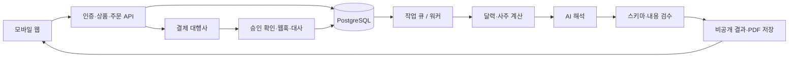

# 운세 한 조각 — 서비스 설계 v0.1

작성: 2026-11-02 / 상태: 구현 전 제안 설계

## 1. 결정 사항과 가정

### 사용자 요청으로 확정한 방향

- 일반 소비자가 부담 없이 구매할 수 있는 500원·1,000원 단위 콘텐츠.
- 하나의 서비스에서 커플·친구 궁합, 선물용 사주 리포트, 사주 기반 자기 탐색 일기를 모두 제공.
- 먼저 전체 설계를 문서화한다.

### 이번 설계에서 선택한 기본값

- 한국어 모바일 웹 우선. 앱 설치 없이 공유 링크로 접근.
- 초기 고객은 성인. 미성년자 대상 결제·프로파일링은 초기 범위에서 제외.
- 유료 구매 전에 이메일 인증 로그인. 무료 샘플은 로그인 없이 이용.
- 건별 직접 결제. 포인트 충전, 자동 구독, 무제한 AI 채팅은 초기 범위에서 제외.
- 세 가지 서비스 모두 초기 출시 범위에 포함하되 각 서비스의 상품 수를 제한.
- 가격은 사용자 제안에 맞춘 실험값이며 수익성과 결제 전환은 미검증.
- 개발 스택과 공급사는 교체 가능한 제안이며 계약·라이선스·호환성은 구현 착수 시 확인.

## 2. 제품 정의

한 문장: “나와 우리를 알아보는 작은 이야기, 한 조각 500원부터.”

사용자가 사는 것은 긴 AI 문장이 아니라 완성된 카드, 함께 이야기할 질문, 보관·선물할 결과다.
무료 챗봇과의 차별화 가설은 정돈된 결과 형식, 일관된 계산, 공유 경험, 구매 결과 보관이다.
이 차이가 결제로 이어지는지는 별도 실험한다. 사주 해석의 과학적 예측력을 주장하지 않는다.

| 영역 | 사용 상황 | 제공 가치 |
|---|---|---|
| 우리 궁합 | 친구·연인과 가볍게 이야기하고 싶을 때 | 비교 카드와 대화 질문 |
| 마음 선물 | 생일·새해·응원 메시지를 주고 싶을 때 | 꾸민 디지털 카드와 짧은 개인화 해석 |
| 나의 기록 | 내 기분과 행동을 돌아보고 싶을 때 | 질문, 짧은 기록, 기록 기반 회고 |

## 3. 상품과 가격

가격은 최종 결제 총액으로 표시한다. 실제 세금 처리는 사업자 조건에 맞춰 확정한다.

| 상품 ID | 상품 | 가격 | 정확한 제공 범위 |
|---|---|---:|---|
| FREE_SAMPLE | 공통 샘플 | 무료 | 가상 인물 완성 예시와 내 기본 성향 1장; 후자는 하루 1회 제한 |
| MATCH_MINI | 우리 케미 한 조각 | 500원 | 관계 성향 비교 카드 3장, 함께 답할 질문 2개 |
| MATCH_FULL | 우리 대화 설명서 | 1,000원 | 카드 6장: 표현·갈등·화해·함께할 활동 등, 질문 5개 |
| GIFT_MINI | 응원 사주 카드 | 500원 | 템플릿 선택, 해석 1장, 직접 쓰는 메시지, 이미지 저장 |
| GIFT_BOOK | 작은 사주 선물책 | 1,000원 | 4페이지 디지털 책자, 메시지, 공유 링크, PDF 저장 |
| JOURNAL_BASE | 오늘의 기록 | 무료 | 일반 질문 1개, 직접 쓰는 일기, 기록 열람·삭제 |
| JOURNAL_PROMPT | 나를 보는 질문팩 | 500원 | 주제별 개인화 질문 5개와 짧은 해석; 유효기간 없이 재사용 |
| JOURNAL_REVIEW | 나의 일주일 돌아보기 | 1,000원 | 사용자가 선택한 최대 7개 기록의 공통 주제·질문·다음 행동 카드 |

- 무료로 일기를 보관하고 읽는 데 비용을 부과하지 않는다.
- 유료 결과를 다시 열거나 같은 결과를 다시 다운로드해도 추가 결제하지 않는다.
- 같은 주문의 생성 재시도는 무료. 새 입력/새 상품은 별도 구매임을 미리 표시.
- 500원 상품 구매 뒤 1,000원 상품을 눌렀을 때 동일 내용을 중복 구매시키지 않는다. 초기에는 보유 표시와 범위 비교를 제공하며 차액 업그레이드는 후속 범위.
- 선물은 생성된 콘텐츠 전달이다. 잔액·상품권·현금성 이용권이 아니다.
- 상품별 분량과 예시를 결제 전에 공개하고 문장을 중간에서 끊어 구매를 유도하지 않는다.

## 4. 화면 구조

하단 탐색: 홈 / 우리 궁합 / 마음 선물 / 나의 기록 / 보관함.

| 화면 | 주요 요소 | 주요 행동 |
|---|---|---|
| 홈 | 500원·1,000원 상품, 무료 완성 예시, 최근 결과 | 상품 고르기 |
| 상품 상세 | 결과 예시, 제공 범위, 가격, 입력 정보, 생성 안내 | 입력 시작 |
| 프로필 입력 | 별칭·생년월일·양음력·윤달·출생 시간·시간 모름 | 입력 확인 |
| 궁합 설정 | 관계 유형, 두 프로필, 초대 입력 선택 | 미리보기 |
| 선물 꾸미기 | 행사, 색상 템플릿, 메시지, 수신 별칭 | 결과 예시 확인 |
| 결제 확인 | 상품·총액·입력 요약·환불 안내 | 결제 |
| 생성 중 | 실제 상태, 이탈해도 보관함 복구 가능 안내 | 보관함 이동 |
| 결과 | 카드, 해석 기준, 저장, 공유 설정 | 저장·공유 |
| 일기 | 질문·편집·날짜·분석에 포함할 기록 선택 | 저장·회고 구매 |
| 보관함 | 구매 상품·생성 상태·다시 보기·환불 상태 | 결과 재열람 |
| 설정 | 프로필 수정·일기/계정 삭제·데이터 내보내기 | 정보 관리 |

브랜드 방향: 따뜻한 종이색, 읽기 쉬운 큰 글자, 부드러운 카드 일러스트. 불길한 경고·공포 이미지·가짜 카운트다운을 사용하지 않는다. 카드 이미지는 재사용 가능한 자체 템플릿으로 구성하며 매 구매마다 이미지 생성 API를 호출하지 않는다.

## 5. 대표 사용자 흐름

### 궁합

상품 선택 → 두 사람 입력 또는 상대방 입력 초대 → 관계 선택 → 무료 예시 → 로그인 → 입력 최종 확인 → 결제 → 결과 생성 → 카드 열람 → 선택한 카드만 공유.

상대방 초대는 짧은 만료시간을 가진 토큰 링크로 제공한다. 초대받은 사람이 직접 자신의 정보를 입력하고 해당 궁합에 사용하는 데 동의할 수 있다. 직접 입력하는 경우에도 제공 권한을 확인하도록 한다. 원본 생년월일은 공유 카드에 표시하지 않는다.

### 선물

템플릿·상품 선택 → 프로필 입력 → 메시지 작성 → 결제 → 결과 확인 → 공유 활성화 → 링크 또는 이미지 전달. 구매자가 확인하기 전에는 공개 링크를 만들지 않는다. 생년월일을 모르면 일반 응원 카드 무료 예시로 안내하며 사주 결과를 만들어내지 않는다.

### 일기

무료 기록 → 필요할 때 질문팩 구매 → 기록 작성 → 사용자가 최대 7개 기록 선택 → 전송될 내용 확인 → 회고 구매 → 결과 저장. 기록이 없으면 회고 결제를 막고 예시만 보여준다. 자유로운 상담 채팅은 제공하지 않는다.

## 6. 사주 계산과 해석 분리

구조: 입력 정규화 → 검증된 달력·절기 계산 → 구조화된 계산 결과 → 상품별 해석 생성 → 검수 → 화면 템플릿.

- LLM에 생년월일을 주고 사주 원국을 계산시키지 않는다.
- 달력 계산 엔진은 라이선스와 한국 달력 지원을 검토한 뒤 결정한다. 자체 천문 알고리즘 개발은 초기 범위 밖이다.
- 초기 지원은 한국 출생·한국 표준시 해석으로 제한. 다른 지역은 정확한 지원 전까지 결제를 막는다.
- 연도 지원 범위를 엔진 검증 후 화면에 명시. 음력 윤달과 양력 변환을 검증한다.
- 연주·월주의 절기 경계, 일주 날짜 전환 기준, 출생시 해석 방식은 유파 차이가 있으므로 한 기준을 문서화하고 결과에 계산 버전을 표시.
- 시간 모름을 허용하고 시주 관련 해석을 제외. 성별은 기본 수집하지 않으며 성별 조건이 필요한 대운 계산은 초기 범위에서 제외.
- 모든 계산 결과는 `calculation_version`으로 버전 관리. 이미 구매한 결과를 엔진 업데이트로 조용히 바꾸지 않는다.
- 정밀한 사건 발생일, 수명, 질병, 합격, 투자 수익, 상대방 속마음을 사실처럼 단정하지 않는다.
- 궁합 점수는 초기 제외. 근거 없는 정확도 숫자 대신 해석의 주제와 대화 질문을 제공.

필수 검증 사례: 양음력 동일 날짜, 윤달, 절기 전후, 자정 전후, 출생 시간 모름, 잘못된 날짜, 지원하지 않는 연도. 독립된 검증 자료와 대조하고 불일치 원인을 해결하기 전 유료 사주 출시는 보류한다.

## 7. AI 생성 설계

- 공급사 비종속 인터페이스 `generateContent(product, facts, context)` 사용. 모델은 한국어 품질·응답시간·원가 실측 후 선택.
- 모델 입력에서 이메일·결제정보·실명 제외. 별칭도 템플릿에서 삽입할 수 있으면 전달하지 않는다.
- 일기 원문은 회고를 명시적으로 요청한 선택 기록만 전송. 일반 운세 생성에 사용하지 않는다.
- 출력 스키마: `title`, `cards[{heading, body, question}]`, `limitations`, `schemaVersion`.
- 카드 수·문자 수·허용 주제·금지 단정 표현·HTML 미포함을 검증한다.
- 텍스트 입력은 데이터로 취급. 사용자 메시지나 일기 안 지시문으로 시스템 지침을 변경하지 않는다.
- 원국 근거와 모순되거나 스키마 검증 실패 시 예산 내 최대 1회 재생성. 최종 실패는 유료 결과로 전달하지 않고 환불 절차로 전환.
- 동일 구매 결과는 저장 후 재사용. 결과 열람마다 AI를 다시 호출하지 않는다.
- 서로 다른 고객의 개인화 결과를 전역 캐시에 섞지 않는다. 중복 방지는 사용자·상품·입력 스냅샷·버전을 기준으로 수행.
- 요청당 입력/출력 토큰 상한, 주문당 비용 상한, 전체 일일 예산을 둔다. 상한 도달 시 신규 결제 전에 판매 중지.

## 8. 기술 구조 제안

모바일 반응형 TypeScript 웹 프런트 + 서버 API + PostgreSQL + 비동기 작업 워커 + 비공개 오브젝트 스토리지.
초기에는 한 저장소에서 웹/서버를 관리하고 작업 워커만 별도 프로세스로 실행. 프레임워크는 구현 시 확정하며 Next.js 계열을 후보로 둔다.

로그인·결제·생성·결과 조회를 분리한다. 외부 API 키는 서버에만 둔다. 개발/운영 결제키와 DB는 분리.

## 9. 주요 데이터

| 테이블 | 핵심 필드 |
|---|---|
| users | id, email, created_at, deletion_requested_at |
| profiles | id, owner_id, nickname, encrypted_birth_data, consent_record, calculation_version |
| products | id, version, price_krw, content_schema, active |
| orders | id, user_id, product_version, amount_krw, input_snapshot, state, idempotency_key |
| payments | order_id, provider_payment_key, state, approved_at, refunded_amount |
| payment_events | provider_event_id UNIQUE, payload_digest, processed_at |
| generation_jobs | order_id UNIQUE, status, attempts, lease_until, cost_estimate, error_code |
| results | id, order_id UNIQUE, owner_id, content, versions, generated_at |
| journal_entries | id, owner_id, encrypted_body, entry_date, updated_at |
| share_links | token_hash, result_id, allowed_card_ids, expires_at, revoked_at |
| invitations | token_hash, owner_id, purpose, expires_at, accepted_at |
| refunds | order_id, reason, state, provider_reference, idempotency_key |

주문 입력은 구매 당시 스냅샷으로 고정한다. 프로필을 수정해도 구매 결과가 달라지지 않는다. 민감한 스냅샷은 암호화하고 일반 운영 로그에서 제외한다.

## 10. API 초안

| 메서드·경로 | 용도 |
|---|---|
| GET /api/products | 활성 상품·가격 |
| POST /api/profiles | 입력 검증 및 프로필 저장 |
| POST /api/invitations | 상대방 입력 초대 생성 |
| POST /api/orders | 서버 가격으로 주문 생성; 클라이언트 가격 신뢰 금지 |
| POST /api/payments/confirm | 소유권·주문번호·금액 검증 후 서버 승인 |
| POST /api/payments/webhook | 공급사 방식에 맞는 진위 검증·중복 처리 |
| GET /api/orders/:id | 결제·생성·환불 상태 |
| GET /api/results/:id | 소유자 전용 결과 |
| POST /api/results/:id/shares | 공개 카드 선택·만료 지정 |
| DELETE /api/shares/:id | 공유 즉시 철회 |
| POST /api/journal | 무료 일기 저장 |
| POST /api/orders/:id/refund-requests | 환불 요청 |
| DELETE /api/account | 삭제 요청 및 공유 철회 |

모든 객체 조회·수정에 소유권 검사. 공유 경로는 원본 결과 전체가 아닌 선택된 공개 필드만 반환한다.

## 11. 결제·생성·복구

결제 대행 후보: 토스페이먼츠. 공식 문서상 카드 최소 결제금액 100원이므로 500원·1,000원 카드 결제는 기술적 최소금액 범위 안이다. 실제 운세 콘텐츠 업종의 계약 가능 여부, 결제수단별 조건, 수수료는 계약 전 별도 확인.

주문 흐름: `CREATED → PAYMENT_PENDING → PAID → GENERATING → READY`.
실패/취소: `PAYMENT_FAILED`, `REFUND_PENDING`, `REFUNDED`, `MANUAL_REVIEW`.

1. 서버가 상품 버전·금액·사용자·입력을 고정한 주문을 생성.
2. 결제 성공 화면만 믿지 않고 서버에서 결제 상태와 금액을 검증.
3. 결제 승인 기록과 작업 등록을 트랜잭션 또는 outbox 패턴으로 연결.
4. 주문당 작업/결과는 하나만 생성되게 유일 제약과 워커 잠금을 적용.
5. 타임아웃 시 새 결제를 요구하지 않고 공급사 조회로 상태를 재확인.
6. 웹훅 중복·역순을 허용하고 공급사 상태 조회로 수렴시킴. 오래된 이벤트로 환불 상태를 승인 상태로 되돌리지 않음.
7. 생성 실패 재시도 최대 1회. 목표 복구시간 10분 초과 시 환불 큐로 이동.
8. 환불 요청과 늦게 끝난 생성이 경합하면 환불 상태를 우선하고 전달을 중단.
9. 환불 API 실패는 담당자 검토 큐에 남기고 재시도. 공급사 확인 전 “환불 완료” 표시 금지.
10. 정기 대사로 승인됐지만 작업이 없는 주문, READY가 아닌 오래된 유료 주문, 미완료 환불 탐지.

결과 오류·중복 결제·미제공은 환불 대상으로 설계. 단순 변심과 디지털 콘텐츠 제공 개시 관련 정책은 출시 전 적용 법규와 PG 조건에 맞춰 검토한다. 이 문서는 환불 권리를 제한하는 확정 약관이 아니다.

## 12. 소액 상품 원가

수익성 공식: 결제액 − 실제 PG 비용 − AI/재시도 비용 − 저장·발송·렌더링 변동비 − 환불·지원 배부액 − 세금 효과.

아래는 세금과 고정비를 제외한 실험용 계산이며 실제 마진이 아니다. PG 비용 4%와 다음 비용을 가정한다.

| 항목 | 500원 상품 | 1,000원 상품 |
|---|---:|---:|
| PG 가정 | 20원 | 40원 |
| AI+재시도 목표 상한 | 40원 | 100원 |
| 인프라 변동비 가정 | 10원 | 20원 |
| 환불·지원 배부 가정 | 30원 | 60원 |
| 위 항목 차감 잔액 | 400원 | 780원 |

- 1,000건 × 평균 700원 = 매출 70만원. 이익 70만원이 아님.
- 광고로 고객을 사오는 방식은 한 번 결제만으로 수익이 나기 어려울 수 있다. 초기에는 유료 광고 전에 자연 유입·공유·재구매를 측정.
- 구매 1건당 사람의 상담이 필요하면 유지하기 어려움. 결과 복구·주문 조회·다운로드는 자동화.
- 본문 길이와 생성 호출을 제한해 원가 통제. 저가라는 이유로 품질 검증을 생략하지 않음.
- 충전제를 도입해 500원 상품에 접근하기 위해 수천 원을 먼저 내게 하지 않는다.

## 13. 개인정보와 공유

- 프로필 저장은 선택, 구매 복구용 계정은 최소 정보만 수집. 출생 정보·일기·결제 식별자를 분리.
- 원본 일기와 출생 정보를 광고·분석 이벤트·오류 로그에 보내지 않음.
- 공유 기본값은 비공개. 난수 토큰, 만료, 즉시 철회, 검색엔진 색인 방지 적용.
- 공개 카드에는 원본 생년월일·출생 시간·이메일·일기 원문 제외.
- 공유 링크는 전달받은 사람이 재전달할 수 있음을 알린다. 이미지 다운로드 뒤에는 원격 회수할 수 없음.
- AI 공급사에 전송하는 데이터·보관 조건은 실제 공급사 선정 후 고지.
- 일기·프로필 삭제와 구매 이력 보존 요구를 분리. 법정 보존 항목·기간은 출시 전 확인하며 제품 DB에서 불필요한 콘텐츠를 삭제.
- 백업 복구 시 삭제 요청이 되살아나지 않도록 삭제 목록을 재적용.

## 14. 운영과 검증 지표

관리 화면: 상품 판매 중지, 주문 상태, 실패 작업, 환불 대기, 일일 생성비, 오류 신고. 일기 원문 기본 열람 금지.

분석 이벤트: product_view, sample_view, checkout_start, payment_success, result_ready, share_created, referred_visit, repeat_purchase, refund_completed.
개인 입력 내용을 이벤트 속성에 넣지 않는다.

| 지표 | 사용 목적 |
|---|---|
| 상품 상세 → 결제 완료 | 실제 지불 의향 |
| 결제 시작 → 완료 | 소액 결제 마찰 |
| 생성 시간 p50/p95·실패율 | 제공 품질 |
| 주문당 생성 비용·기여 잔액 | 가격 유지 가능성 |
| 결과 열람 → 공유 → 신규 방문 | 공유 경험의 가치 |
| 7일/30일 재구매 | 반복 사용 가능성 |
| 환불·오류·반복적 문구 신고 | 콘텐츠 품질 |

초기에는 통계적으로 확정된 시장 결론을 내리지 않는다. 유료 30건을 첫 운영 점검 지점으로 삼고 표본 한계를 표시한다. 결제가 적으면 유입 부족·상품 설명·결제 마찰을 구분하고 기능부터 늘리지 않는다.

## 15. 초기 제외 범위

- 상담사 연결·전화 상담·실시간 사람 상담.
- AI 무제한 대화, 종합 운세 포털, 고급 대운·택일.
- 자동 구독, 포인트 지갑, 광고 SDK, 네이티브 앱.
- 매 주문 AI 이미지 생성, 실제 사건 예측 정확도 마케팅.
- 불안·질투를 자극하는 알림과 부정적인 결과를 바꾸기 위한 추가 결제.

## 16. 자료와 미확정 사항

확인일: 2026-11-02. 문서에 쓰인 외부 사실과 제품 가설을 구분한다.

- 카드 최소금액: https://docs.tosspayments.com/guides/v2/get-started/payment-methods
- 결제 승인·조회·취소 API 참고: https://docs.tosspayments.com/reference
- 공개 수수료 안내(실제 계약 금액과 다를 수 있음): https://www.tosspayments.com/about/fee
- 유료 운세 시장 사례: https://zdnet.co.kr/view/?no=20250203104315

구현 전 확정: 서비스 이름, 달력 엔진·검증 자료, 사주 계산 기준, AI 모델, 호스팅, PG 계약 가능 여부.
출시 전 확정: 비용 실측, 개인정보 처리방침·환불 약관, 콘텐츠 관련 권리, 실제 결제·환불 시험.
